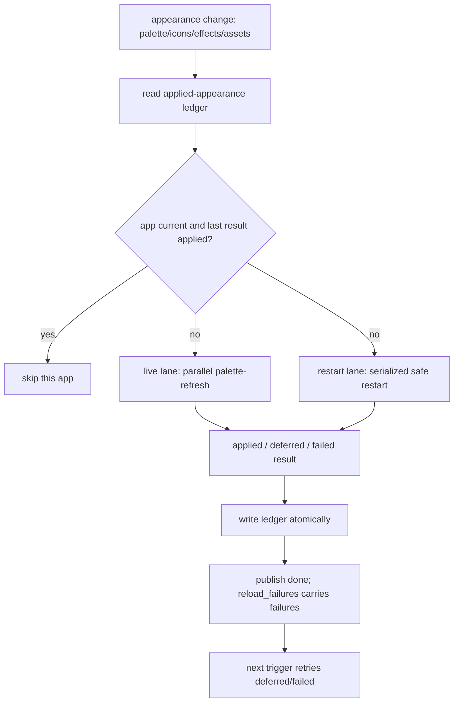
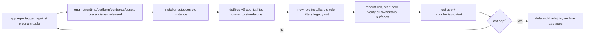

# Architecture Spine — Standalone AGS app repos and the palette-refresh contract

## Design Paradigm

Ports-and-adapters (hexagonal) remains the application paradigm. This slice adds a
process-level contract: each app is a standalone deployable unit, and the runtime is
the driver that invokes the app's declared refresh behavior. The migration is
strangler-fig: app manifests are adopted first, the runtime switches once, then the
old `ags-apps` monorepo shrinks one app at a time and is archived.

| Layer | Lives in | Contains |
| --- | --- | --- |
| Canonical contract | `contracts` | manifest schema, install-list schema, `palette-refresh` protocol, result/log schema |
| App-side helper | `ags-platform` | manifest types + refresh handler helper; one-provider Theme fix |
| App units | one repo per app | app package, manifest, handler, tests, AGENTS/tickets |
| Process driver | `dotfiles-runtime` | discovery/identity, appearance ledger, parallel live lane, serialized restart lane |
| Composition | `dotfiles-v3` | the single per-app list, pins, deploy coverage, cutover gate |
| Installer | `dotfiles-provision` | generic install loop, legacy-role filter, verify, stop/start |
| Old unit | `ags-apps` | migration workshop only; archived at the end |

The per-app split is **conditional on the pilot exit gate** in REQ-009: the
clipboard repo must prove the repo template, CI/release, one-owner cutover,
live refresh, install/rollback and measured harness cost. If the pilot fails, the
program stops and no further app moves.

## Inherited Invariants

The parent spine `architecture-ags-platform-2026-10-09` is binding read-only except
where this spine explicitly supersedes it.

| Inherited | From parent | Binds here |
| --- | --- | --- |
| AD-1 dependency direction | AGS Platform spine | apps → platform; no app → app; `contracts` is an app's test-time schema dependency, not a runtime import |
| AD-5 one event client | AGS Platform spine | apps consume the platform client; no local event-bus copies |
| AD-6 contract is the single source | AGS Platform spine | manifest, install-list, command and result schemas live only in `contracts` |
| AD-13 Theme is a port | AGS Platform spine | every live refresh routes palette application through the Theme port; the port's provider replacement is a hard prerequisite |
| AD-17 distribution: versioned unit + shared ancestor | AGS Platform spine | extended by AD-31: per-app units share one `<install>/apps/node_modules/ags-platform` |
| AD-19 gate discipline | AGS Platform spine | every app/consumer repo gates its own change; the tree stays green |
| AD-20 sequenced migration | AGS Platform spine | manifests first, runtime switch second, app repos third; no big-bang |
| AD-21 one icon manifest | AGS Platform spine | unchanged; AD-37 fixes its single producer |
| AD-22 one producer per topic | AGS Platform spine | the runtime is the sole palette-refresh trigger; apps do not invent a palette event |
| AD-23 operational envelope | AGS Platform spine | per-repo CI, pinned installs, fresh-host verification extended by AD-31/32 |

**Supersessions recorded here:**

- The parent spine's Deferred item “per-app repo split” is activated only through
  the measured REQ-009 pilot gate above.
- The 2026-10-16 `GUIDE-ags-app-repos-refinement.md` decision to stay at three
  repos is superseded *conditionally* by this program; the pilot is the exit-gate
  proof, not a post-hoc validation.
- The self-hosted typecheck clause in inherited AD-19/AD-23 is superseded by the
  current stock-runner-only reality: typecheck is local and authoritative; CI runs
  pure tests and drift gates.
- The current `AgsReloader` skip/restart policy and the `hypr-pano` fixed names are
  replaced by the manifest contract and the clipboard rename (AD-35).

## Invariants & Rules

### AD-25 — One repo per app; the repo root is the app

- **Binds:** all app repos, deployment
- **Prevents:** monorepo coupling, a `source_subdir` matrix, and app → app imports.
- **Rule:** seven repos: `ags-bar`, `ags-notifications`, `ags-capture-tool`,
  `ags-clipboard`, `ags-wallpaper-selector`, `ags-icme`,
  `ags-btop-theme-studio`. The repo root is the app package (`app.tsx` at root). The
  deployed config link points at the repo root. No app imports another app.
  `ags-apps` is only the migration workshop and is archived when the last app moves.

### AD-26 — Manifest identity and discovery are single-valued

- **Binds:** every app repo, `dotfiles-runtime`
- **Prevents:** a hardcoded runtime app list, wrong-instance refresh, and a
  schema-valid manifest pointing at a different deployed app.
- **Rule:** every app repo carries `app.manifest.json` at its root, deployed with the
  app. Required fields: `schemaVersion: 1`, `app`, `instance`, `configDir`,
  `mode: live | restart`, `holdsUnsavedState: boolean`. The fixed command is
  `palette-refresh`. Identity must satisfy:
  `manifest.instance == app.tsx instanceName == ags list name`,
  `manifest.configDir == deployed config-link basename`, and both are one lowercase
  path segment. The runtime enumerates **every deployed link** under
  `<install>/config` (including `config/ags`) and reads its manifest. A missing or
  invalid manifest is a structured failure entry for that app, not a silent skip and
  not a restart. Running status comes from `ags list`/`/proc`; the owner process for
  a name must resolve to the same deployed link/config dir. A foreign or dev
  instance that owns a deployed name is a structured conflict and is never
  refreshed. Live apps are invoked only when running; restart apps are included
  from the configured link even when the process is down. Dev/worktree instances
  are ignored unless an explicit `--include-dev` is passed. Duplicate names or
  duplicate links are structured failures. The bar is discovered through
  `config/ags` and its manifest; it is not a hardcoded policy. `mode: restart` is
  invalid when `holdsUnsavedState` is true.

### AD-27 — The runtime is the only palette-refresh trigger; live refresh preserves state

- **Binds:** `dotfiles-runtime`, live apps
- **Prevents:** event/command double refresh, apps inventing palette-change
  semantics, and live refresh discarding unsaved or in-flight state.
- **Rule:** after the palette repoint and the appearance-ledger gate, the runtime
  invokes each running live app:
  `ags request palette-refresh <appearance-hash> -i <instance>`. The app returns a
  **single JSON-encoded string** on stdout, exactly once, after the refresh has
  fully completed. The permitted shapes are:
  `{"ok":true}` (applied), `{"ok":true,"deferred":"reason"}` (accepted but not
  applied yet), or `{"ok":false,"error":"...","retryable":true|false}`. A JSON
  object literal is forbidden (AGS's transport is a string); the app must call
  `res(JSON.stringify(...))`. Malformed/empty/extra output, non-zero exit or the
  5 s timeout is a failure. `ok:true` without `deferred` means applied, not
  scheduled. The handler is re-entrant or returns `{"ok":false,"error":"busy",
  "retryable":true}` while another refresh is in progress. `palette-refresh` must
  be non-destructive: apps with `holdsUnsavedState: true` preserve pending edits;
  apps with an active transient surface preserve it or return `deferred`/busy.
  The app repo test proves the declared state class. `wallpaper.state` remains the
  progress/UI event; its contract description must be updated to say it no longer
  drives palette refresh. Live apps do not subscribe to it for palette.

### AD-28 — Parallel live lane, serialized restart lane, runtime-owned structured logs

- **Binds:** `dotfiles-runtime`
- **Prevents:** serial refresh latency, AGS bundle collisions, untraceable failures,
  and two different observability shapes.
- **Rule:** live apps run in parallel, each with a 5 s timeout; one failure does not
  stop the others. The runtime is the sole emitter of the per-app contract record:
  one JSON Lines record per app per operation with `runId`, app, instance, config
  dir, mode, phase, appearance hash, start/end, duration, argv, exit code, parsed
  response, error, timeout and discovery index. App-internal logs are separate.
  `reload_failures` becomes a structured list of
  `{app, instance, mode, status, reason, detail}` with a string-compatible view for
  the notification card; invalid-manifest entries are included. Summary order is
  ascending discovery index. Restart apps run in a serialized lane: send quit, wait
  up to 5 s for the D-Bus name/process to release, fail and report if it does not,
  then launch. **Every** `ags run` invocation — runtime restart, provisioning,
  autostart and on-demand launchers — holds the same per-user AGS launch lock, so
  the shared bundle can never race. Live and restart lanes may overlap because
  `ags request` does not bundle. `wallpaper.state done` is published after both
  lanes; there is no immediate retry within the operation.

### AD-29 — One applied-appearance ledger, one runtime operation lock

- **Binds:** `dotfiles-runtime`
- **Prevents:** no-op reconciles refreshing/restarting, failed apps skipped forever,
  icons-only changes missed, and concurrent triggers double-refreshing.
- **Rule:** the runtime owns one persisted **applied-appearance ledger** under
  `$XDG_STATE_HOME/dotfiles/` (or a schema-versioned extension of an existing state
  file), with one writer. It records the appearance hash (palette + icons + effects
  + icon-manifest inputs), operation id, completion time and a per-app map
  `{instance, mode, status: applied|deferred|failed|skipped, appearanceHash,
  reason}`. It is written atomically after both lanes settle. A configured app is
  refreshed when its last successful appearance hash differs from the current hash
  or its last result is `failed`/`deferred`; otherwise it is skipped. This makes the
  next trigger retry a failed/deferred app — defined as recovery, not an automatic
  fallback. Icons-only `regenerate` and `wallpaper set`/`reconcile` share the
  ledger. A single runtime operation lock serializes daemon, CLI and `wallpaper
  set`; an older operation never writes its hash after a newer one. If the palette
  pointer moved during the operation, the ledger is not marked applied for that
  hash.

### AD-30 — Restart is explicit, all-times-safe, and never a fallback

- **Binds:** `dotfiles-runtime`, app manifests
- **Prevents:** hidden fallback, lost unsaved work, and the login restart storm.
- **Rule:** `mode: restart` means the app is safe to restart at any moment, including
  while visible or mid-operation, without losing anything the user cares about. It
  is invalid for an editor or any app with `holdsUnsavedState: true`. A failed live
  refresh never becomes a restart. The final restart set is the bar only; every
  other app is live. The bar's ADR records why restart is sufficient; moving it to
  live is a future iteration. Restart uses the AD-28 procedure. A configured
  restart app is included from its deployed link even when its process is down, so
  the lane can recover a failed bar; a failed restart is recorded in the ledger and
  retried on the next trigger. The only launch path is this explicit restart lane
  for a configured restart app; there is no hidden launch on the live path.

### AD-31 — One program tuple, per-app installs, one shared platform ancestor

- **Binds:** `dotfiles-v3`, `dotfiles-provision`, deployment
- **Prevents:** a monorepo pin, per-app platform version skew, a broken esbuild
  resolution path, and duplicate ownership surfaces.
- **Rule:** install each app at `<install>/apps/<installDir>/<tag>/` (the
  `installDir` defaults to the app id; use it to disambiguate e.g. `capture` from
  `ags-capture-tool`). Link `config/ags` to the bar and `config/ags-*` to the other
  apps. Create exactly one shared `<install>/apps/node_modules/ags-platform`
  shortcut, an ancestor of every app checkout. The deployment has **one program
  tuple record** (`dotfiles-v3/dotfiles/provisioning/program-tuple.yaml`) naming
  the `ags-platform`, `contracts` and `dotfiles-assets` (icon source) tags. The
  record is validated by a schema in `contracts` and consumed by the installer.
  It is released once during adoption; a tuple bump is a program-wide event that
  revalidates every app, never a per-cutover change. Every app repo builds/tests
  against that exact tuple and carries no `node_modules`/vendored platform in its
  tag. The current `ags-apps` monorepo is re-pinned to the same tuple during the
  adoption release and keeps its existing per-unit platform shortcut pointing at
  the same tuple until it is removed; only the standalone installs use the shared
  `apps/node_modules` ancestor. The single
  machine-readable app list lives at `dotfiles/provisioning/apps.yaml`, validated
  by a schema in `contracts`; `dotfiles-provision` and verify consume it. The list
  fields include `app`, `installDir`, `owner: legacy|standalone`, repo/tag
  (standalone), instance, configDir, `configLink`, `spineLink`, `xdgLink`,
  `binLink?`, `launcher?`, `autostart?`, `launch`, `barPalettePointer?`, and
  `cutoverId`. The old role filters `owner: legacy`; the new role filters
  `owner: standalone`. At program completion no `ags-apps` pin remains.

### AD-32 — The cutover is an epoch, not a cross-repo commit

- **Binds:** `dotfiles-v3`, `dotfiles-provision`, `dotfiles-runtime`,
  `dotfiles-assets`, app repos
- **Prevents:** zero/two owners, a new manifest paired with old running code, and a
  half-migrated app.
- **Rule:** a cutover is an explicit epoch:
  1. the app repo is tagged against the current program tuple;
  2. the program tuple is the one released during adoption; a cutover releases
     only the app repo and, if its code changed, the engine/runtime. A platform/
     contracts/assets tuple bump is a separate program-wide event, never part of
     a single-app cutover;
  3. the installer quiesces the old instance (confirmed quit, no process, no D-Bus
     name) before any link change;
  4. the `dotfiles-v3` app list flips that app's `owner` to `standalone` in one
     composition commit — the old role filters `owner: legacy`, the new role filters
     `owner: standalone`, so exactly one role acts;
  5. the installer installs the new tag, repoints the link, starts the new instance,
     and verifies identity/manifest/ownership on every surface, plus the
     `palette-refresh` handler for live apps;
  6. the app is tested end to end; launcher/autostart/assets entries are updated in
     the same epoch;
  7. the old role may only shrink. When the last app moves, delete the old role/pin
     and archive `ags-apps`.
  The ownership predicate covers **all** surfaces named by the app-list schema:
  source checkout, spine link, XDG link, bin link, launcher, autostart entry,
  running process and D-Bus name. A fake-app cutover fixture proves quiesce →
  flip → install/start → verify and the reverse rollback. A config link is never
  hot-swapped under a running process.

### AD-33 — Each app repo carries the dev flow; the pilot proves the harness

- **Binds:** every app repo
- **Prevents:** inconsistent governance, template drift, and an unmeasured
  multi-repo tax.
- **Rule:** REQ-008 creates a template fixture at
  `ags-apps/templates/ags-app/`; the pilot (`ags-clipboard`) is its first
  consumer and carries the frozen template at `ags-clipboard/templates/ags-app/`.
  Every app repo carries `AGENTS.md`, `tickets/` (LIFECYCLE, INDEX, `_template/`),
  `scripts/worktree-guard.sh`, Makefile, CI, README, manifest and tests; live apps
  also carry the `palette-refresh` handler. A template-conformance gate validates
  the required files, manifest shape, handler presence for live mode and ticket
  flow. App-local work is ticketed there; cross-app program work stays in
  `ags-apps` until archive. Releases use immutable annotated tags; typecheck is
  local, pure tests run in stock CI.
  The pilot exit gate is measurable: scaffold-to-green ≤ 30 min using the
  documented template copy (no generator required); CI/release overhead ≤ 10 min
  per app; install ≤ 2 min; rollback ≤ 2 min; zero duplicate and zero missing
  ownership surfaces; no app restart for a palette change except the declared bar;
  no bespoke provisioning code beyond the app-list entry. The pilot records actual
  wall times. If any threshold fails, the program stops.

### AD-34 — Contract ownership, one deployed tuple, schema evolution

- **Binds:** `contracts`, `ags-platform`, app repos, `dotfiles-runtime`
- **Prevents:** schema drift, two deployed platform versions, and app CI passing
  against a tuple the host cannot run.
- **Rule:** `contracts` owns the manifest schema, install-list schema,
  `palette-refresh` protocol and result/log schema. `ags-platform` provides the
  TypeScript helper/types. `dotfiles-runtime` validates deployed manifests against
  the program's `contracts` pin. Each app repo pins the exact `contracts`,
  `ags-platform` and `dotfiles-assets` tags of the program tuple for its
  conformance test; app CI may declare a compatibility range, but the install gate
  requires equality. The current monorepo is re-pinned to the same tuple during
  adoption. `contracts` is a test-time schema dependency for app repos; apps do not
  import it at runtime except through the platform. `schemaVersion` starts at 1;
  unknown versions are a structured failure, never a crash. Annotated tags are
  immutable; a published tag is never moved. No package registry: git tags.

### AD-35 — The clipboard app is renamed end to end, including its data paths

- **Binds:** `ags-clipboard`, `dotfiles-runtime`, `dotfiles-v3`,
  `dotfiles-provision`, `dotfiles-assets`
- **Prevents:** a misleading `hypr-pano` name surviving in code, links or user data.
- **Rule:** repo `ags-clipboard`; config dir `ags-clipboard`; AGS instance
  `clipboard`; window `clipboard-window`; launcher `clipboard-ui`; keybind
  description “Open clipboard history”. The runtime clipboard daemon keeps its
  command name `dotfiles-runtime clipboard` but moves its config/state/cache paths
  to the `clipboard` namespace, with a one-time migration from the old
  `hypr-pano` paths (config, history, cache) so history and preferences survive.
  Update autostart, launcher, keybind, runtime docs/tests, manifests and docs. The
  old `hypr-pano` app/config names are retired; the old data paths remain only as a
  migration source and are removed after the migration is proven.

### AD-36 — Manifests and handlers are adopted before the runtime switches

- **Binds:** `ags-apps`, `ags-clipboard`, `dotfiles-runtime`, `dotfiles-v3`,
  `dotfiles-provision`
- **Prevents:** a no-legacy runtime leaving unmigrated apps stale, a switch before
  live handlers exist, and platform drift between the old monorepo and new repos.
- **Rule:** before the manifest-driven runtime is enabled:
  1. the current `ags-apps` monorepo is re-pinned to the program tuple
     (`ags-platform` + `contracts` + `dotfiles-assets`) and released as a new tag;
  2. every currently deployed app — including the bar and every still-monorepo app —
     receives `app.manifest.json` in its deployed config dir;
  3. every live app receives a `palette-refresh` handler in the same monorepo
     release, wrapping its existing refresh behavior; the bar has no handler and is
     `restart`;
  4. the bar's manifest lives at `config/ags/app.manifest.json`.
  The runtime switch is one release after this adoption. The app repo extraction
  then moves the same manifest/handler with the source; no second runtime mode is
  introduced. A missing manifest or handler is a structured failure, not a legacy
  restart.

### AD-37 — Installed tags are immutable; writable state lives outside them

- **Binds:** `dotfiles-provision`, `dotfiles-runtime`, app repos
- **Prevents:** two writers to one generated file, a tag bump resetting user state,
  and rollback reading stale state.
- **Rule:** after provisioning clones a tag, `<install>/apps/<installDir>/<tag>/` is
  read-only. All writable user state lives under `$XDG_CONFIG_HOME/` or
  `$XDG_STATE_HOME/`, never inside the tag. `colors.css` is a symlink created once
  at install inside the tag, pointing to a **stable runtime pointer outside the
  tag**; the runtime seeder updates that pointer, never the tag, and provisioning
  only verifies it. `icons.json` has one producer: the platform artifact generated
  from the pinned `dotfiles-assets` tuple, with provisioning verifying byte
  equality and never writing it; app repos do not hand-author a second manifest.
  Existing in-tag state (for example the bar's `wifi-speedtest*.json`) moves to XDG
  state before the bar cutover; a tag-bump test proves it survives. Rollback is a
  link repoint to an immutable tag plus the same external state.

## Consistency Conventions

| Concern | Convention |
| --- | --- |
| Repo names | `ags-<app>`; clipboard is `ags-clipboard` |
| Config dirs | `ags` for the bar; `ags-notifications`, `ags-capture`, `ags-clipboard`, `ags-wallpaper-selector`, `ags-icme`, `ags-btop-studio` |
| Manifest | `app.manifest.json` at repo root; `schemaVersion`, `app`, `instance`, `configDir`, `mode`, `holdsUnsavedState` |
| Identity | manifest instance == app.tsx instanceName == `ags list`; configDir == config-link basename; one lowercase path segment |
| Command | fixed `palette-refresh`; appearance hash as the only argument |
| Response | one JSON-encoded string on stdout: `{"ok":true}`, `{"ok":true,"deferred":"..."}`, or `{"ok":false,"error":"...","retryable":bool}`; object literals forbidden |
| Timeout/failure | 5 s per live app; malformed/empty/extra/non-zero/timeout = failure; no immediate retry |
| Recovery | the applied-appearance ledger retries `failed`/`deferred` apps on the next trigger |
| Logging | runtime-owned JSON Lines per app: runId, identity, mode, hash, timings, argv, exit, response, error |
| Summary order | ascending discovery index, not completion order |
| Failure surface | structured `reload_failures` with a string view; notification card; invalid manifests included |
| Ownership surfaces | app-list schema names source, spine/XDG/bin links, launcher, autostart, process and D-Bus name; verify checks all |
| Launch lock | one per-user lock for every `ags run` (runtime, provisioning, autostart, on-demand launchers) |
| Versioning | annotated immutable git tags; one `program-tuple.yaml` naming `ags-platform`/`contracts`/`dotfiles-assets`; app CI pins it |
| Dev flow | AGENTS + tickets + worktree guard + Makefile + CI + template conformance in every app repo |

## Stack

| Name | Version |
| --- | --- |
| AGS CLI / JS package | 3.1.0 / 3.1.2 (host package is AUR git; pinning is a separate open item) |
| TypeScript | 5.9 repo pin (local typecheck; confirm the pin before the first repo) |
| Python runtime | 3.14.7 |
| `ags-platform` / `contracts` / `dotfiles-assets` | one program tuple per install; exact tags set at REQ-008 release, then pinned by every app repo |
| Distribution | GitHub HTTPS, immutable annotated tags, no package registry |

## Structural Seed

### Install topology

```text
<install>/
  apps/
    bar/<tag>/
    notifications/<tag>/
    capture/<tag>/
    clipboard/<tag>/
    wallpaper-selector/<tag>/
    icme/<tag>/
    btop-theme-studio/<tag>/
    node_modules/ags-platform -> ../../ags-platform/<version>/
  config/
    ags -> ../apps/bar/<tag>
    ags-notifications -> ../apps/notifications/<tag>
    ags-capture -> ../apps/capture/<tag>
    ags-clipboard -> ../apps/clipboard/<tag>
    ags-wallpaper-selector -> ../apps/wallpaper-selector/<tag>
    ags-icme -> ../apps/icme/<tag>
    ags-btop-studio -> ../apps/btop-theme-studio/<tag>
```

### App list seed

```yaml
apps:
  - app: clipboard
    owner: standalone
    installDir: clipboard
    repo: https://github.com/RandomGenericUsername/ags-clipboard.git
    tag: v0.1.0
    instance: clipboard
    configDir: ags-clipboard
    configLink: ags-clipboard
    spineLink: ags-clipboard
    xdgLink: ags-clipboard
    launcher: clipboard-ui
    autostart: clipboard
    launch: on-demand
  - app: bar
    owner: legacy
    installDir: bar
    configLink: ags
    spineLink: ags
    xdgLink: ags
    launch: always
    barPalettePointer: true
```

The list is the sole ownership source: the old role filters `owner: legacy`, the new
role filters `owner: standalone`. Flipping one entry is the cutover transaction.

### App repo seed

```text
ags-clipboard/
  app.tsx
  app.manifest.json
  style.css
  AGENTS.md
  tickets/
    LIFECYCLE.md
    INDEX.md
    _template/
  scripts/worktree-guard.sh
  Makefile
  .github/workflows/
  templates/ags-app/
  tests/
```

```json
{
  "schemaVersion": 1,
  "app": "clipboard",
  "instance": "clipboard",
  "configDir": "ags-clipboard",
  "mode": "live",
  "holdsUnsavedState": false
}
```

### Refresh flow



### Cutover epoch



### App map

| App | Repo | Instance | Config dir | Mode |
| --- | --- | --- | --- | --- |
| bar | `ags-bar` | `ags` | `ags` | `restart` |
| notifications | `ags-notifications` | `notifications` | `ags-notifications` | `live` |
| capture | `ags-capture-tool` | `capture` | `ags-capture` | `live` |
| clipboard | `ags-clipboard` | `clipboard` | `ags-clipboard` | `live` |
| wallpaper selector | `ags-wallpaper-selector` | `wallpaper-selector` | `ags-wallpaper-selector` | `live` |
| icme | `ags-icme` | `icon-color-mapping-editor` | `ags-icme` | `live` |
| btop studio | `ags-btop-theme-studio` | `btop-theme-studio` | `ags-btop-studio` | `live` |

## Capability → Architecture Map

| Capability / area | Lives in | Governed by |
| --- | --- | --- |
| App unit extraction | app repos | AD-25, AD-33 |
| Manifest + refresh protocol | contracts, ags-platform, app repos | AD-26, AD-27, AD-34 |
| Runtime driver, ledger, logs, gates | dotfiles-runtime | AD-27, AD-28, AD-29, AD-30 |
| Manifest + handler adoption / monorepo re-pin | ags-apps, app repos, runtime | AD-36 |
| Per-app install / one program tuple | dotfiles-v3, dotfiles-provision | AD-31, AD-34 |
| Cutover epoch / retirement | dotfiles-v3, dotfiles-provision, ags-apps | AD-32 |
| Installed-tag immutability / state | dotfiles-v3, dotfiles-provision, app repos | AD-37 |
| Clipboard rename | ags-clipboard + consumers | AD-35 |
| Dev flow / template / exit gate | pilot repo, all app repos | AD-33 |

## Workstreams by repo

| Repo | Owns | Flow |
| --- | --- | --- |
| `contracts` | manifest schema, install-list schema, `palette-refresh` + result/log protocol, `wallpaper.state` note | ticket/OpenSpec in its own repo |
| `ags-platform` | manifest helper/types; Theme one-provider replacement (blocking); template-conformance helper | ticket/OpenSpec in its own repo |
| `dotfiles-runtime` | discovery/identity, applied-appearance ledger, operation lock, parallel live lane, serialized restart lane, logs, deferred/failed statuses, clipboard daemon rename/data migration, bar restart fix | ticket/OpenSpec in its own repo |
| `dotfiles-v3` | single app list, `program-tuple.yaml`, deploy coverage, cutover gate, docs | OpenSpec change in its own repo |
| `dotfiles-provision` | generic install loop, legacy/standalone owner filters, verify, quiesce/stop/start link swap, launcher/autostart consumption, tag immutability, shared launch lock | ticket/OpenSpec in its own repo |
| `ags-apps` | EPIC-002/children, monorepo re-pin + manifest/handler adoption release, template fixture, pilot, app sources until moved, archive | existing ticket flow |
| each app repo | AGENTS/tickets, manifest, handler, tests, tag, release, templates/ags-app, template conformance | its own ticket flow |
| `dotfiles-assets` | clipboard autostart/keybind rename; icon source tuple; shared launch-lock wrapper for launchers | its own flow |

## Deferred

- **`palette.changed` event** — not introduced; command-driven refresh is the
  contract. Revisit only if a non-runtime producer must signal appearance changes.
- **Bar live refresh** — bar stays `restart`; moving it to live is a future iteration
  with a measured benefit.
- **AGS host pin** — the AUR git package is unpinned; record the operational risk
  and revisit before a fresh-host guarantee.
- **TypeScript 5.9 pin** — confirm the pin is deliberate before the first repo.
- **Exact program tuple tags** — set at the REQ-008 release; the rule (one tuple per
  install, app CI equality) is binding.
- **`ags-apps` archive mechanics** — GitHub archive vs deletion at REQ-016.
- **Template generator** — the template fixture and conformance gate are required;
  an automated repo generator is deferred until the pilot proves the copy.
- **Invalid-manifest UX beyond structured logs** — logs + app CI; no new UI.
- **Bar `wifi-speedtest` state migration** — must move to XDG state before REQ-015;
  the exact file/layout is a bar-child detail.
- **Clipboard data migration** — the old `hypr-pano` data paths are a one-time
  migration source; removal after the pilot proves history/preferences survive.
- **Exact icon artifact path** — the single-producer rule and assets tuple are
  binding; the exact path/generator implementation is a REQ-008 acceptance detail.

## Evidence

| Claim | Evidence |
| --- | --- |
| Current split, btop gap, provider accumulation | `tickets/SPIKE-001-ags-refresh-patterns/ticket.md` |
| Previous three-repo decision and exit gate | `dotfiles-v3/docs/GUIDE-ags-app-repos-refinement.md` §7 |
| Parent AD-1/5/6/13/17/19/20/21/22/23 | `dotfiles-v3/_bmad-output/planning-artifacts/architecture/architecture-ags-platform-2026-10-09/ARCHITECTURE-SPINE.md` |
| Current monorepo install shape | `dotfiles-provision/ansible/roles/ags_apps/vars/main.yml` |
| Current runtime restart/skip behavior | `dotfiles-runtime/src/runtime/adapters/ags_reloader.py` |
| Theme provider accumulation | `ags-platform/adapters/theme.ts`; `/usr/share/ags/js/lib/gtk4/app.ts:174-215` |
| `apps/node_modules/ags-platform` esbuild resolution | reviewer prototype: app run through `config/ags-req` with the shared ancestor resolves `ags-platform/adapters/theme`; the `config/node_modules`-only negative control fails |
| `ags request` transport is a string; no built-in timeout | `/usr/share/ags/js/lib/gtk4/app.ts:272-296`; `/usr/share/ags/js/lib/app/dbus.ts`; `ags request --help` |
| Decisions and alternatives | `_bmad-output/initiative-ags-standalone-apps/architecture-standalone-app-contract/.memlog.md` |
